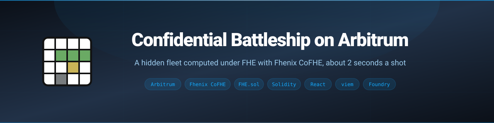
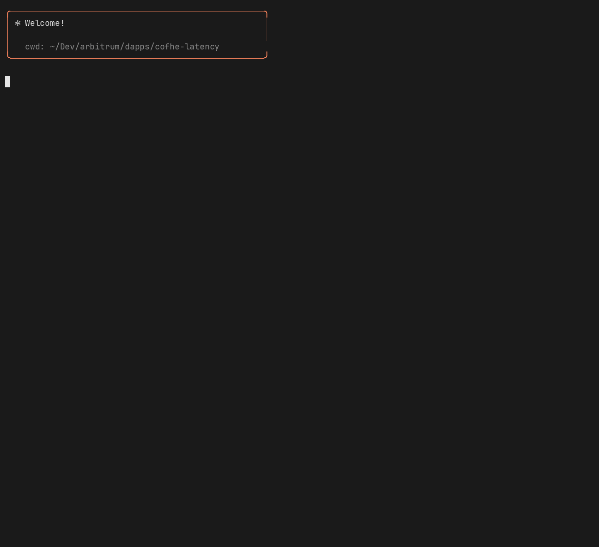

<p align="center">
  
</p>

<p align="center">
  <a href="LICENSE"></a>
  <a href="https://docs.arbitrum.io/build-decentralized-apps/public-chains"></a>
  <a href="https://cofhe-docs.fhenix.zone/cofhe/get-started/introduction/what-is-cofhe"></a>
  
  
  <a href="https://github.com/hummusonrails/confidential-battleship-arbitrum/pulls"></a>
</p>

<p align="center">
  <strong>Battleship against a fleet nobody can see, computed under fully homomorphic encryption on Arbitrum.</strong>
  <br>
  <a href="https://hummusonrails.github.io/confidential-battleship-arbitrum/">Play it</a> · <a href="#quick-start">Quick Start</a> · <a href="#building-with-agent-harnesses">Building with Agent Harnesses</a> · <a href="https://github.com/hummusonrails/confidential-battleship-arbitrum/issues">Report a Bug</a>
</p>

## What It Does

- **Hides the fleet from everyone.** `FHE.randomEuint8` places four ships onchain and they stay encrypted. Nobody can read them: not the player, not the deployer, not the contract.
- **Answers every shot under FHE.** Fhenix CoFHE checks the shot against the encrypted fleet and reveals only miss, hit or sunk.
- **Runs at game speed on Arbitrum.** A shot is two transactions plus a CoFHE decryption, and on Arbitrum Sepolia the whole round trip takes about 2 seconds.
- **Races two chains.** The race page fires every cell on Arbitrum Sepolia and Ethereum Sepolia at once, with a stopwatch on each stage of every shot.
- **Plays without popups.** A burner key in the browser signs each shot, and the wallet dialog tops it up from MetaMask.
- **Measures itself.** Scripts time each stage of a shot and the block times behind it, and a headless player checks that every revealed answer is consistent.

## How a Shot Works

```text
 fire                         decrypt                          reveal
 ──────────────────────────   ──────────────────────────────   ──────────────────────────────
 fire(gameId, cell)           CoFHE computes on the encrypted  reveal(gameId, result, sig)
 lands in an Arbitrum block   fleet, decrypts only the answer  publishes the signed answer
 (encrypted result handle)    and signs it                     in the next Arbitrum block
```

The board is four 4x4 sectors with one ship in each (lengths 4, 3, 3, 2). A shot computes `hit` and `sunk` under FHE and folds them into one encrypted `euint8` (0 miss, 1 hit, 2 sunk), so each shot needs only one decryption. Every shot runs the same FHE operations, so gas says nothing about the answer.

```solidity
euint64 ship = game.ships[sectorOf(cell)];
ebool hit = FHE.ne(FHE.and(ship, FHE.asEuint64(bit)), zero64);
// Sunk when no cell of the ship is left unhit, counting this one.
ebool sunk = FHE.eq(FHE.and(ship, FHE.asEuint64(~(game.hitMask | bit))), zero64);
euint8 result = FHE.select(hit, FHE.select(sunk, sunkCode, hitCode), missCode);
FHE.allowThis(result);
FHE.allowPublic(result);
```

## Measured Speed

Median per stage, October 29, 2026:

| Stage | Arbitrum Sepolia | Ethereum Sepolia |
|:------|:-----------------|:-----------------|
| `fire`: shot included onchain | 0.46 s | 11.41 s |
| `decrypt`: CoFHE compute and decryption | 1.23 s | 0.22 s |
| `reveal`: result published onchain | 0.38 s | 11.59 s |
| Whole shot | **2.10 s** | 25.60 s |

On Ethereum, CoFHE finishes while the next 12 s block is still on its way, so `decrypt` returns at once. On Arbitrum the chain adds under a second per shot, which leaves CoFHE's own computation as the largest stage.

| Full game on Arbitrum Sepolia | Result |
|:------------------------------|:-------|
| Shots to sink the fleet | 53, every answer checked |
| Median shot | 1.99 s |
| Whole game | 107 s |
| `newGame` (four encrypted random ships) | 2.73M gas, 0.53 s |

| Network | Average block time (from block timestamps) |
|:--------|:-------------------------------------------|
| Arbitrum One | 279 ms over 200,000 blocks |
| Arbitrum Sepolia | 259 ms over 200,000 blocks |
| Ethereum | 12.08 s over 2,000 blocks |
| Ethereum Sepolia | 12.01 s over 2,000 blocks |

Raw runs are in `results/`.

## Quick Start

Play the deployed game at [hummusonrails.github.io/confidential-battleship-arbitrum](https://hummusonrails.github.io/confidential-battleship-arbitrum/), or run it locally:

```bash
git clone https://github.com/hummusonrails/confidential-battleship-arbitrum.git
cd confidential-battleship-arbitrum
npm install
npm run dev
```

The app uses the contracts already deployed on Arbitrum Sepolia and Ethereum Sepolia (`web/src/deployments.json`). Open **Wallet** to fund the burner with testnet ETH, then press **Play**.

<details>
<summary><strong>Prerequisites</strong></summary>

- [Node.js](https://nodejs.org/) 20 or later
- [Foundry](https://book.getfoundry.sh/getting-started/installation), to build and deploy the contracts
- Python 3, for `blocktimes.py`
- Testnet ETH on [Arbitrum Sepolia](https://www.alchemy.com/faucets/arbitrum-sepolia) (and [Ethereum Sepolia](https://www.alchemy.com/faucets/ethereum-sepolia) for the race)

</details>

## Usage

Deploy your own contract and play a full game headless. `selfplay.mjs` fires until every ship sinks, then checks that each sector held one straight ship of the right length, with SUNK on its last cell.

```bash
cp .env.example .env            # add a funded testnet PRIVATE_KEY
set -a; . ./.env; set +a
npm run build                   # contracts, then the ABI the web app reads
node selfplay.mjs arbitrum-sepolia --deploy
node selfplay.mjs arbitrum-sepolia
```

Time each stage of a shot, and measure block times:

```bash
node latency.mjs arbitrum-sepolia 10
node latency.mjs ethereum-sepolia 6
python3 blocktimes.py
```

Build the web app for static hosting. The build uses relative paths, so it works from any subpath, and `.github/workflows/pages.yml` deploys it to GitHub Pages on every push to `main`.

```bash
npm run build:web               # output in dist/
```

## Building with Agent Harnesses

Fhenix publishes the [fhenix-toolkit](https://github.com/FhenixProtocol/fhenix-toolkit): skills and a reviewer agent that teach a coding agent current `FHE.sol` and `@cofhe/sdk` patterns. The skills cover the hard rules of confidential contracts (branchless logic with `FHE.select`, `FHE.allowThis` after every stored write, allow before emit), encrypted randomness, decryption flows, testing, and review for side channels such as gas that varies with a secret.

In an agent harness that supports plugin marketplaces:

```text
/plugin marketplace add FhenixProtocol/fhenix-toolkit
/plugin install fhenix-toolkit
```

| Skill | Use it for |
|:------|:-----------|
| `fhenix-contracts` | Writing Solidity with `FHE.sol`: ACL rules, branchless updates, randomness, decryption |
| `fhenix-sdk` | Client code with `@cofhe/sdk`: encrypting inputs, permits, decrypting |
| `fhenix-tests` | Tests with the CoFHE mocks for Foundry and Hardhat |
| `fhenix-review` | Reviewing a confidential contract for leaks and ACL mistakes |

The recording replays the session that built `src/Battleship.sol` with the toolkit: the `fhenix-contracts` skill loads, the agent applies its rules to the fleet and the shot logic, builds with Foundry, and plays a full game on Arbitrum Sepolia to check the encrypted fleet.

<p align="center">
  
</p>

<details>
<summary><strong>Session transcript</strong></summary>

```text
> /plugin marketplace add FhenixProtocol/fhenix-toolkit

⏺ Plugin(marketplace add)
  ⎿  Added marketplace fhenix-toolkit from FhenixProtocol/fhenix-toolkit

> /plugin install fhenix-toolkit

⏺ Plugin(install)
  ⎿  Installed fhenix-toolkit 0.2.0
     skills: fhenix-contracts, fhenix-sdk, fhenix-tests, fhenix-review
     agents: fhe-reviewer

> Build Battleship against a house fleet nobody can see, not even the deployer. One encrypted shot per tx,
  reveal only miss / hit / sunk.

⏺ Skill(fhenix-contracts)
  ⎿  Loaded fhenix-contracts: write confidential Solidity for Fhenix CoFHE

⏺ The fleet has to come from onchain randomness, since anything the player or deployer encrypts in the browser is
  known to them. Checking the hard rules and the randomness pattern before writing.

⏺ Read(fhenix-contracts/references/hard-rules.md)
  ⎿  Rule 1: No if / require on ebool → FHE.select
     Rule 2: FHE.allowThis(x) after every stored encrypted write
     Rule 7: Order allow* calls before emit / return
     Rule 10: allowPublic is irreversible, publish only what the game reveals

⏺ Read(fhenix-contracts/references/concepts/randomness-via-entropy.md)
  ⎿  FHE.randomEuintXX is fine when the FHE engine can be trusted
     Beware modulo bias for small ranges: negligible for n = 2, 3

⏺ Read(fhenix-review/references/concepts/pattern-leakage.md)
  ⎿  Gas profile: different op paths cost different gas; make both arms identical

⏺ Plan: four 4x4 sectors, one ship each (4, 3, 3, 2). One FHE.randomEuint8 per ship picks orientation, line and
  offset; the ship mask is FHE.shl of a plaintext shape. A shot computes hit and sunk under FHE and folds them
  into one euint8, so CoFHE decrypts once per shot. Both outcomes run the same ops, so gas leaks nothing.

⏺ Bash(grep -nE "function (randomEuint8|shl|rem|select|publishDecryptResult)\(" FHE.sol)
  ⎿  randomEuint8() · shl(euint64, euint64) · rem(euint8, euint8)
     select(ebool, euint8, euint8) · publishDecryptResult(euint8, uint8, bytes)

⏺ Write(src/Battleship.sol)
  ⎿  Wrote the fire function: hit and sunk computed under FHE, one euint8 result, allowThis and allowPublic
     before the Shot event

⏺ Bash(forge build)
  ⎿  Compiling 1 files with Solc 0.8.25
     Compiler run successful!

⏺ A unit test cannot see the fleet, so the real check is a full game: fire until every ship sinks, and confirm
  each sector held one straight ship of the right length with SUNK on its last cell.

⏺ Bash(node selfplay.mjs arbitrum-sepolia)
     [arbitrum-sepolia] game 1 started in 0.53 s
     [arbitrum-sepolia] shot 1 at B7: HIT  | fire 0.29 s, decrypt 1.32 s, reveal 0.38 s, total 1.99 s
     [arbitrum-sepolia] shot 8 at B1: HIT  | fire 0.55 s, decrypt 1.22 s, reveal 0.26 s, total 2.03 s
     [arbitrum-sepolia] shot 15 at G5: HIT  | fire 0.47 s, decrypt 1.21 s, reveal 0.43 s, total 2.11 s
                         …
     [arbitrum-sepolia] shot 34 at F5: SUNK | fire 0.41 s, decrypt 1.22 s, reveal 0.25 s, total 1.88 s
     [arbitrum-sepolia] shot 37 at B4: SUNK | fire 0.42 s, decrypt 2.43 s, reveal 0.34 s, total 3.19 s
     [arbitrum-sepolia] shot 41 at B8: SUNK | fire 0.52 s, decrypt 1.28 s, reveal 0.36 s, total 2.16 s
     [arbitrum-sepolia] shot 53 at G3: SUNK | fire 0.36 s, decrypt 1.22 s, reveal 0.25 s, total 1.84 s
     [arbitrum-sepolia] won in 53 shots, fleet checked; median shot 1.99 s, whole game 107.08 s

⏺ Fleet verified onchain. Every shot is two transactions plus a CoFHE decrypt, and on Arbitrum the whole round
  trip lands in about 2 seconds. That makes a confidential game feel like a game.
```

</details>

See [Build with AI](https://cofhe-docs.fhenix.zone/cofhe/get-started/build-with-ai/build-with-ai) in the Fhenix docs for more on using the toolkit.

## Stack

| Layer | Tool | Notes |
|:------|:-----|:------|
| Chain | Arbitrum Sepolia, Ethereum Sepolia | Same contract on both, for the race |
| Confidential compute | [Fhenix CoFHE](https://cofhe-docs.fhenix.zone/cofhe/get-started/introduction/what-is-cofhe) | FHE coprocessor: encrypted randomness, shot logic, signed decryption |
| Contracts | Solidity 0.8.25, `@fhenixprotocol/cofhe-contracts`, Foundry | `FHE.sol` types and operations |
| Client | `@cofhe/sdk`, viem | `decryptForTx` for each shot, `eth_sendRawTransactionSync` for receipts |
| Frontend | React 18, Vite | Static build, hash routing, deploys to GitHub Pages |

## Project Structure

```text
.
├── src/
│   ├── Battleship.sol        # the game: encrypted fleet, fire, reveal
│   └── ShotLatency.sol       # one shot end to end, for latency.mjs
├── web/
│   ├── index.html
│   └── src/
│       ├── game.js           # burner account, CoFHE client, shot pipeline with per-stage timing
│       ├── tx.js             # fast sends: cached gas and fees, sync receipts, local nonces
│       ├── battle.js         # React state for one chain's game
│       ├── pages.jsx         # hub, splash, game page, race page
│       ├── components.jsx    # board, stopwatch, dialogs
│       └── deployments.json  # contract addresses per network
├── selfplay.mjs              # headless full game with fleet checks
├── latency.mjs               # per-stage timing for one shot
├── blocktimes.py             # block intervals from block timestamps
├── results/                  # raw latency runs
└── .github/workflows/pages.yml
```

## Learn More

- [A gentle introduction to Arbitrum](https://docs.arbitrum.io/welcome/arbitrum-gentle-introduction)
- [Block numbers and time on Arbitrum](https://docs.arbitrum.io/build-decentralized-apps/arbitrum-vs-ethereum/block-numbers-and-time)
- [What is CoFHE?](https://cofhe-docs.fhenix.zone/cofhe/get-started/introduction/what-is-cofhe)
- [How FHE operations run for chains like Arbitrum One](https://cofhe-docs.fhenix.zone/cofhe/fhe-library/core-concepts/data-evaluation)
- [CoFHE quick start for Arbitrum Sepolia and Arbitrum One](https://cofhe-docs.fhenix.zone/cofhe/fhe-library/introduction/quick-start)
- [Randomness in CoFHE](https://cofhe-docs.fhenix.zone/cofhe/fhe-library/core-concepts/randomness)

## Contributing

Bug reports and ideas are welcome in [issues](https://github.com/hummusonrails/confidential-battleship-arbitrum/issues), and pull requests are welcome too.

## License

[MIT](LICENSE)
